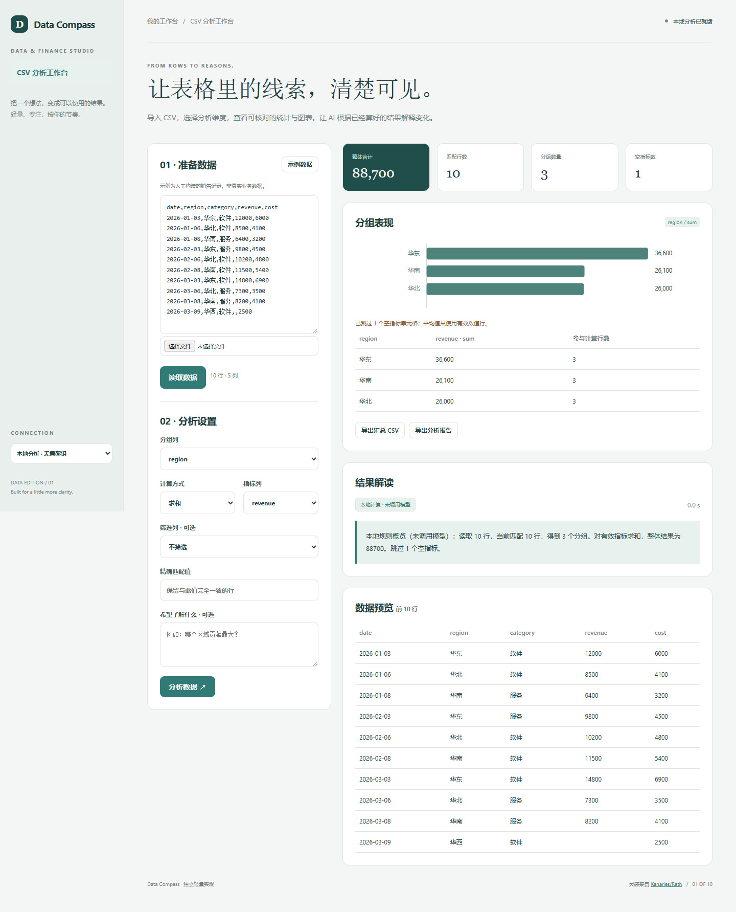

# Data Compass

导入 CSV，选择分析维度，查看可核对的统计与图表。让 AI 根据已经算好的结果解释变化。

- CSV 导入与预览，支持引号、逗号与多行字段
- 分组求和、均值、计数与精确筛选
- 本地计算、图表与可导出的汇总表
- 可选 AI 解读，仅发送聚合摘要



## 快速开始

需要 Node.js 24 或更新版本；无第三方运行依赖，无需 npm install。

```sh
git clone https://github.com/Yiwen-Yang-BA/chatgpt-data-compass.git
cd chatgpt-data-compass
npm start
```

打开 http://127.0.0.1:3201 。默认进入**本地分析模式**，不调用 API；统计值由本地代码计算。示例数据为人工构造，界面明确标注。

### 接入真实模型

复制 `.env.example` 为 `.env`，填写 `OPENAI_API_KEY`，按账号权限设置 `OPENAI_MODEL`，然后重启服务并切换界面中的「AI 解读」。`OPENAI_BASE_URL` 必须支持 OpenAI Responses API；仅兼容 Chat Completions 的服务不适用。密钥只在服务端读取，不写入前端或仓库。

```sh
# Docker（可选；必须显式传入配置）
docker build -t chatgpt-data-compass .
docker run --rm -p 127.0.0.1:3201:3201 --env-file .env chatgpt-data-compass
```

## 使用方法

1. 载入构造示例，或导入自己的 CSV；点击读取数据。
2. 选择分组列、指标列、统计方式，可添加一个精确匹配筛选。
3. 点击分析，核对表格、图表与缺失值提示。
4. 可添加一个问题帮助组织解读，再导出聚合 CSV 或 JSON 报告。

## 计算口径

求和与均值仅使用筛选后非空的有效数值；均值的整体汇总按全部有效行计算，非分组均值的简单平均。计数包含筛选后所有行。空指标跳过并计数；非空的非数字指标会报错。最多 2,000 行、30 列、100 组，CSV 最多 250,000 字符。数字使用小数点，可用科学计数法；逗号分组金额须预先清理。

## 验证

```sh
npm run check
npm test
```

测试覆盖业务规则以及本地 HTTP 服务、模拟模型接口、输入校验和错误处理。真实付费模型调用需要用户配置有效密钥，未将本地分析测试作为真实模型质量验证。GitHub Actions 在每次推送时运行检查。

## 参考与复刻范围

灵感来自 [Kanaries/Rath](https://github.com/Kanaries/Rath)（AGPL-3.0）。查询快照：2026-10-04；4,687 stars；最近推送 2026-08-14。这是当前星标量与更新状态，**不是近一个月新增星标排名**。

本仓库是对其核心交互和用途的独立轻量实现，未复制上游源码、商标或静态资源，不声称实现上游的全部功能，也不属于上游官方产品。

独立复刻 CSV 导入、字段选择、分组聚合、图表与可选 AI 解释的核心流程。计算结果由确定性数据处理产生，AI 仅解释已计算结果；不复刻自动因果发现、任意代码执行、数据库连接或整套商业智能平台。

## 模型接收的数据

读取数据不调用模型。AI 解读只接收列名、分组聚合表、统计摘要和用户问题，不发送逐行原始数据。分组名称仍可能包含业务信息。

## 数据与部署边界

输入与结果只保留在当前页面，不持久保存；导出文件可备份。 本地分析数据不离开本机；AI 解读仅发送本项目 README 说明的统计摘要到所配置的模型服务。

默认只监听 127.0.0.1，适用于单人本地使用；没有多用户登录或持久数据库。如需公网部署，请先增加身份验证、配额和 HTTPS。服务限制请求大小、并发和超时，禁止从静态目录读取密钥文件。

接口实现依据 [OpenAI 官方文本生成文档](https://developers.openai.com/api/docs/guides/text)。

## License

MIT — independent implementation.
